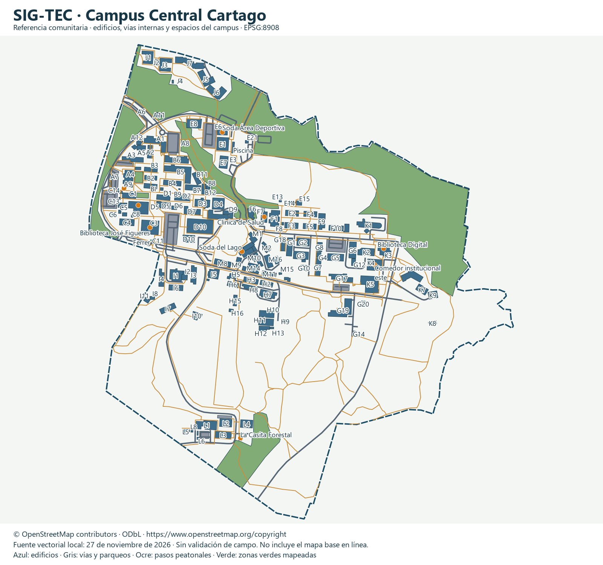

# Mapas de referencia de las sedes

SIG-TEC 0.2 añade un fondo OpenStreetMap para las cinco sedes y una referencia
vectorial local de Cartago. Las ocho vistas editables de PostgreSQL conservan
los datos ficticios de la demostración. Los datos comunitarios aparecen en un
grupo propio de consulta: **Cartago · referencia OpenStreetMap**.



La imagen se generó con QGIS a partir de los vectores locales, sin abrir QGIS
Desktop ni descargar teselas. Es una vista previa del conjunto de datos; la
comprobación visual del complemento en Desktop está pendiente.

## Uso en QGIS

Después de instalar o recargar el complemento:

1. Abrir **Database → SIG-TEC → Ver mapa del campus…** y elegir la sede.
2. Cartago muestra edificios, vías, pasos peatonales, parqueos, áreas verdes,
   servicios y el límite según OSM. Las otras cuatro sedes muestran el mapa
   base centrado en su ubicación de referencia.
3. El mapa base requiere Internet. Los vectores de Cartago están incluidos en
   el complemento y se pueden consultar sin Internet. La atribución de OSM
   aparece en la esquina inferior del mapa.
4. Abrir **Ver capas editables de la sesión** para regresar a las ocho vistas
   cargadas con la cuenta de campus. Las acciones de mapa cambian visibilidad
   y extensión, sin guardar ni descartar ediciones pendientes.

El mapa de referencia es público y puede abrirse sin autenticación. Las vistas
de PostgreSQL siguen requiriendo la cuenta correspondiente. Al entrar en una
sesión se añade el fondo debajo de las capas editables. Cargar un mapa varias
veces reutiliza el fondo y la referencia ya existentes.

## Contenido y precisión

La extracción del **27 de noviembre de 2026, hora de Costa Rica**, usa el
límite OSM de Cartago y el área acotada indicada en el manifiesto. Los horarios
de ese manifiesto están en UTC, por lo que figuran como 28 de noviembre.

| Archivo local | Objetos | Interpretación |
| --- | ---: | --- |
| `edificios.geojson` | 151 | Contornos de edificios; los nombres y códigos son los registrados en OSM. |
| `carreteras.geojson` | 91 | Tramos viales dentro del campus. |
| `aceras.geojson` | 332 | Senderos, pasos peatonales y escaleras; no todos son aceras inspeccionadas. |
| `parqueos.geojson` | 10 | Polígonos etiquetados como parqueos. |
| `zonas_verdes.geojson` | 6 | Áreas verdes explícitamente mapeadas; no cubren toda la vegetación. |
| `puntos_interes.geojson` | 9 | Servicios en nodos o puntos representativos de polígonos OSM. |
| `accesibilidad.geojson` | 1 | Paso con accesibilidad etiquetada; no certifica la accesibilidad de una ruta completa. |
| `iluminacion.geojson` | 0 | No se encontraron luminarias etiquetadas en esta extracción. |
| `limite.geojson` | 1 | Límite comunitario del campus, sin carácter catastral. |

Un objeto puede aparecer en más de una categoría, por ejemplo un edificio que
contiene una biblioteca. Los identificadores `osm_id` incluyen tipo e ID de
OSM; son distintos del `id BIGINT` global de los objetos de SIG-TEC. No se
infieren pisos, capacidades, estado, potencia o ancho que la fuente no aporte.

Los GeoJSON de entrada están en **EPSG:4326**. QGIS los transforma al sistema
del proyecto al representarlos; el proyecto nuevo usa **EPSG:8908**. Una futura
importación a las tablas geográficas debe transformar la geometría a 8908,
asignar IDs del campus y validar los atributos y los tipos Polygon/LineString.
Esta versión no importa los vectores a PostGIS ni modifica la semilla.

## Fuentes

- [OpenStreetMap: límite de Cartago, way/40819609](https://www.openstreetmap.org/way/40819609).
- [San José, way/199579277](https://www.openstreetmap.org/way/199579277).
- [San Carlos, node/9210148464](https://www.openstreetmap.org/node/9210148464).
- [Alajuela, node/14250954024](https://www.openstreetmap.org/node/14250954024).
- [Limón, way/665308676](https://www.openstreetmap.org/way/665308676).
- [Plano institucional de Cartago, versión de febrero de 2023](https://www.tec.ac.cr/mapa-campus).
  Sirvió para contrastar la biblioteca José Figueres Ferrer, código C-3,
  registrada como C3 en OSM. No se digitalizaron geometrías del PDF ni se
  verificaron todos los nombres del conjunto contra ese plano.

Las cajas de `sedes.json` definen encuadres de navegación. Para las sedes cuya
referencia es un nodo, no representan el lindero del inmueble.

Los datos derivados de OSM se distribuyen bajo **ODbL 1.0**, con atribución a
sus colaboradores. La licencia y los SHA-256 están en
[fuentes.json](../qgis/sig_tec/datos/cartago/fuentes.json). Al exportar mapas
desde QGIS se debe incluir el crédito y el enlace de licencia en la composición;
el crédito del mapa interactivo no sustituye al del archivo exportado.
[Licencia y atribución](https://www.openstreetmap.org/copyright).

## Actualizar y validar

Desde la raíz, con el Python de QGIS 3.44 LTR en Windows:

```powershell
$env:QT_QPA_PLATFORM = 'offscreen'
& 'C:\Program Files\QGIS 3.44.15\bin\python-qgis-ltr.bat' qgis/herramientas/actualizar_cartago_osm.py
& 'C:\Program Files\QGIS 3.44.15\bin\python-qgis-ltr.bat' qgis/pruebas/test_mapas.py
& 'C:\Program Files\QGIS 3.44.15\bin\python-qgis-ltr.bat' qgis/herramientas/exportar_cartago.py docs/imagenes/cartago-referencia.png
```

El extractor también acepta `--osm RUTA` para procesar un archivo local. El
manifiesto registra la fecha de extracción, el hash de ese archivo y los de
los GeoJSON. El archivo OSM bruto es temporal y no se publica en Git. Revisar
los cambios de conteos y geometrías antes de actualizar el complemento.

El fondo usa el servicio XYZ nativo de QGIS y su caché. No se generan paquetes
de teselas, descargas anticipadas ni mapas offline de ese servidor público.
[Política del servicio](https://operations.osmfoundation.org/policies/tiles/).

## Comprobaciones

Las cinco pruebas nuevas verifican hashes, geometrías válidas y trazables,
encuadres de las cinco sedes en 8908, referencia de solo lectura, reutilización
sin duplicados y conservación de una edición pendiente al alternar vistas.
También comprueban que recargar el complemento repone la atribución y no
duplica sus acciones. Corren con Qt `offscreen`, sin controlar el escritorio ni
renderizar teselas del servicio OSM.

Queda por comprobar en QGIS Desktop la apariencia del fondo, el crédito
visible, los cinco encuadres y la alternancia con la sesión real. El proyecto
debe seguir permitiendo guardar solo los objetos del campus autenticado.
